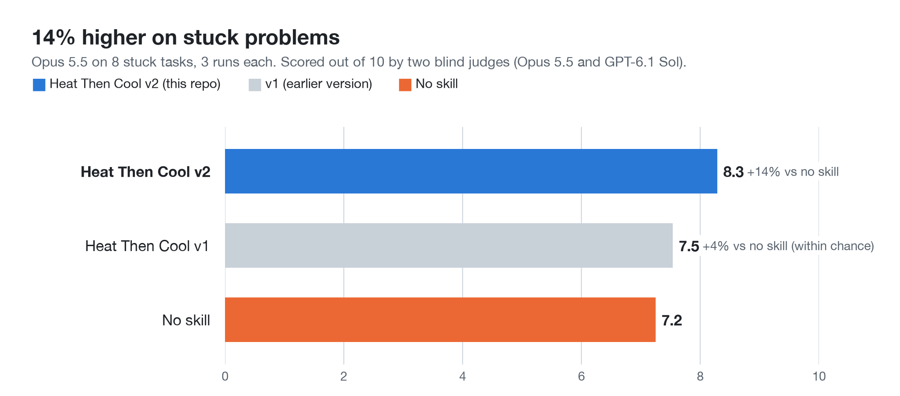
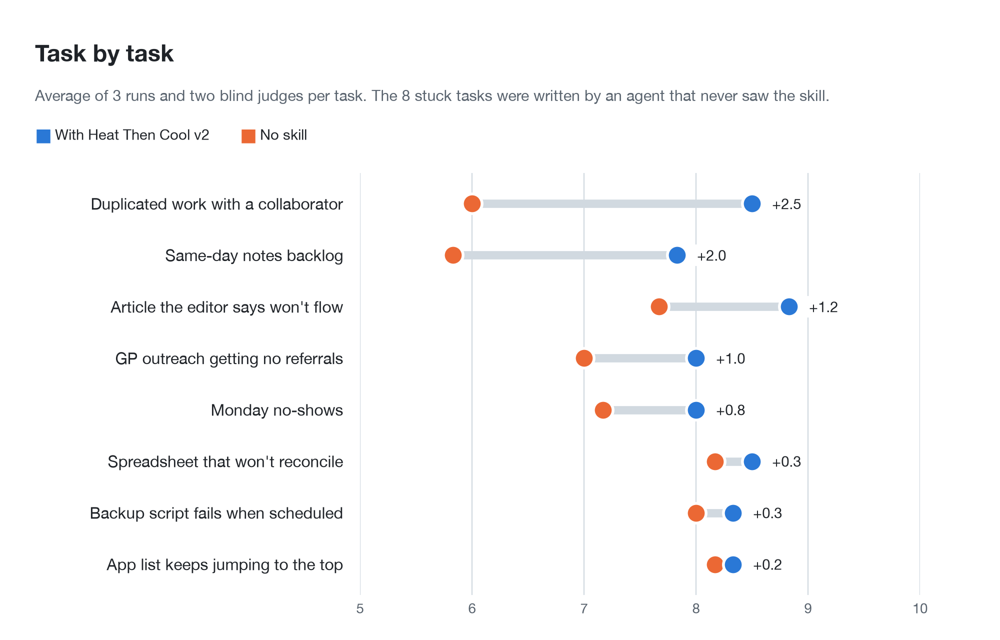

# Heat Then Cool

When Claude has tried several different fixes and none of them moved the result, this skill makes it loosen its grip on the explanation it has been working from, re-read the evidence, consider explanations of a different kind, and keep only what survives a check. Works in Claude Code and any agent that reads `SKILL.md` files.

<picture>
  <source media="(prefers-color-scheme: dark)" srcset="assets/charts/stuck-tasks-dark.png">
  
</picture>

  

## Install

Run these two commands inside Claude Code:

```
/plugin marketplace add rightin2/heat-then-cool
/plugin install heat-then-cool@heat-then-cool
```

<details>
<summary>Manual install</summary>

Copy the skill folder into your Claude Code skills folder:

```bash
git clone https://github.com/rightin2/heat-then-cool.git
cp -r heat-then-cool/skills/heat-then-cool ~/.claude/skills/
```

</details>

## Try it

You do not need to call it by name. It starts only when the conversation shows two or more attempts that were different in kind and changed nothing. On a first try, or a question where nothing has failed yet, Claude answers as it normally would.

Prompts that set it off:

```
Sam and I keep building the same feature twice. We tried a Notion board, then daily Slack standups, then a weekly Loom walkthrough. It happened again last week.
```

```
By Friday I have 8 to 10 unwritten session notes. I tried a timer per note, a reward for zero backlog, and moving my notes block to 7am. None of it stuck.
```

If the failed attempts were all variations on one approach (the same message reworded, the same setting nudged), the companion skill [Look at the Frame](https://github.com/rightin2/look-at-the-frame) is the one that fits. The two never run together.

## How it works

Claude does this in its thinking:

1. **Treat the current explanation as one candidate,** not the answer.
2. **Re-read the raw evidence** (error text, numbers, the person's own words) and mark what that explanation made it skip.
3. **Heat:** write four or more explanations that differ in kind, including one that contradicts the current belief and one at a different level, such as the data, the setting or the process. No judging yet.
4. **Cool:** test them one at a time against hard facts and drop the ones that fail. Any explanation that rests on guessing someone's motives is dropped.
5. **For each survivor, find a check** whose result would tell it apart from the others, cheapest first.

What you see is plain: it opens on the clue that most changes the picture, gives the cause and the fix if the evidence points to one, and otherwise gives two or three likely causes, each with what would confirm it, as "if you find X, do A; if Y, do B". No worksheet, no percentages, and never longer than a plain answer.

## Example: the feature built twice

<details>
<summary>What the reply looked like</summary>

The opening of the skill's real answer to the first prompt in the blind test, which both judges scored 9 out of 10:

> All three fixes report what already happened. The board shows status when someone remembers to update it, the standup covers yesterday, and the Loom covers last week. None of them makes either of you say "I'm taking this" before you start, and with only two hours of overlap a day, a duplicate can run for days before any report catches it. Your own wording points at the gap: "pull a card from Next and start."

It then asked the person to look back at the two incidents to see which cause it was: one card started without a visible claim, the same work on two cards, or work started off the board. Each came with its own fix, such as "claim before code" for the first. It ended by changing the daily standup to say what each person is starting today, not what they did yesterday.

</details>

## Does it work?

Claude Opus 5.5 answered 10 tasks it had never seen, 3 times each, with and without the skill: 8 stuck problems (bugs, writing, scheduling, outreach) and 2 ordinary requests where nothing had failed. Two judges from different model families, Opus 5.5 and OpenAI's GPT-6.1 Sol, scored every answer out of 10 without knowing which setup wrote it.

On the stuck problems the skill averaged **8.3 against 7.2 with no skill, 14% higher**. The 95% range for the gain is 0.69 to 1.42 points, so it is well above chance, and the two judges gave it the same average (8.3 each). On the 2 ordinary requests it scored slightly higher than no skill (8.2 against 7.8), and its answers were a little shorter (504 words against 529). Across all 60 judgements it was picked as the best answer 24 times, against 6 for no skill.

It scored higher than no skill on all 8 stuck tasks, most on the problems about people, routines and writing.

<picture>
  <source media="(prefers-color-scheme: dark)" srcset="assets/charts/by-task-dark.png">
  
</picture>

**What changed since the first version.** The first version did worse than no skill in its first test (8.1 against 8.5 on 5 tasks) and was only 4% ahead on these 10 tasks, within chance. Its answers were too long, printed their working, and added facts the person never gave. Version 2 applies [ten fixes](evals/v2-test/FIXES.md): it fires only on repeated failure, keeps its method in its thinking, caps length, and uses only facts the person gave.

Every score and the judges' reasons are in [`evals/v2-test/results.json`](evals/v2-test/results.json), with the tasks in [`tasks.json`](evals/v2-test/tasks.json). The first version and its first test are kept in [`evals/skill-v1.md`](evals/skill-v1.md) and [`evals/v1-test-results.json`](evals/v1-test-results.json).

## What's inside

```
skills/heat-then-cool/SKILL.md     the skill: when it fires, what Claude does, what you see
.claude-plugin/plugin.json         plugin manifest for Claude Code
.claude-plugin/marketplace.json    lets /plugin marketplace add find it
evals/v2-test/                     the 10 test tasks, the results and the ten fixes
evals/skill-v1.md                  the first version of the skill
evals/v1-test-results.json         the first test of the first version
assets/charts/                     the result charts and make_charts.py, which draws them from the results
```

## Limits

- It needs failed attempts it can see in the conversation. On a first try it has nothing to work from.
- The old explanation stays in Claude's context. Re-reading the evidence is a guard, not a guarantee.
- Its different explanations can turn out to be one idea reworded.
- Loosening a belief also makes a false insight more likely. The cooling step and the checks are there to catch that, and you still have to run the checks.
- The ten fixes were drawn from what earlier judges praised and criticised, using the same scoring rules, so part of the gain may be learning what judges reward.
- The evidence is 8 stuck tasks and 2 ordinary ones, with Opus 5.5 answering and models judging, not people.

## Origin

The idea comes from Robin Carhart-Harris's work on the psychedelic state: the entropic brain (2014) and REBUS, with Karl Friston (2019). Their account is that psychedelics loosen the brain's high-level beliefs, so information from the senses can flow up and revise them. They compare it to annealing in metalwork: heat lets a stuck structure move, and slow cooling lets it settle into a better one. The same loosening also makes false insight more likely, which is why this skill only keeps what survives a check. It came out of a project mining John Vervaeke's lecture series *Awakening from the Meaning Crisis*, where he describes the shaman's practices as ways of breaking up habitual pattern-finding so a better pattern can form.

## Licence

MIT. See [LICENSE](LICENSE).
